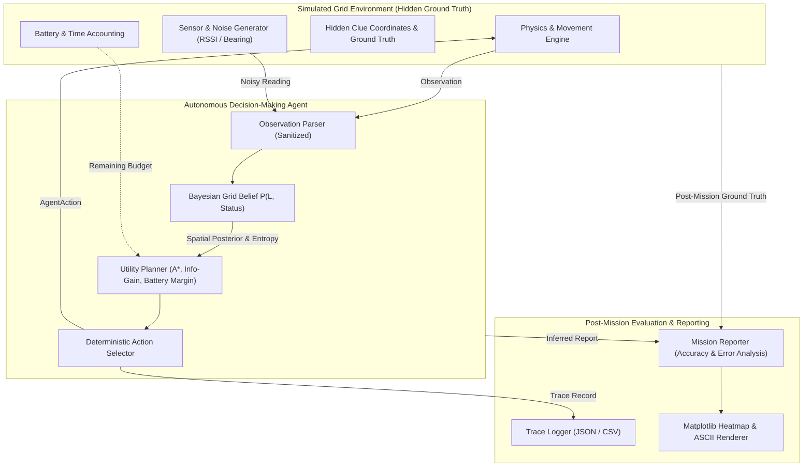
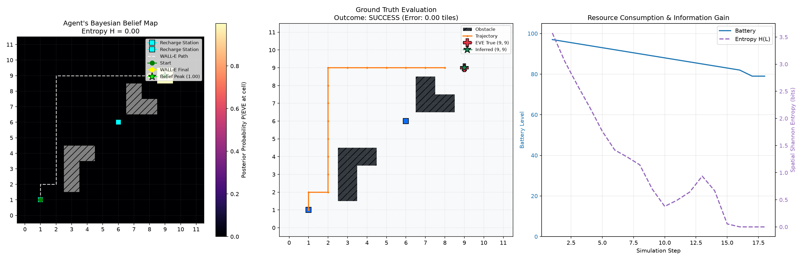

# WALL-E and EVE's Signal: Autonomous Search & Probabilistic State Estimation

[](https://www.python.org/downloads/)
[](https://opensource.org/licenses/MIT)
[]()
[]()

> **OS Vinnovate Autonomous Agent Challenge Deliverable**  
> **Repository:** [https://github.com/abhi-45-dev/os-vinnovateproj](https://github.com/abhi-45-dev/os-vinnovateproj)  
> **Author:** Abhiram ([@abhi-45-dev](https://github.com/abhi-45-dev))

---

## 1. Executive Summary & Problem Statement

In a post-apocalyptic desolate environment, **WALL-E** must locate **EVE** using intermittent, noisy radio frequency pings and sparse environmental clues while adhering to strict operational constraints: limited battery reserves, time budget, and impassable obstacles.

Crucially, **WALL-E operates under strict partial observability**:
- The agent **never** receives hidden ground-truth coordinates of EVE.
- Clue coordinates are discovered strictly through physical interaction and proximity.
- Observations consist exclusively of noisy path-loss signals, directional bearings, surrounding terrain passability, and intercepted telemetry packets.
- The agent must maintain and update a recursive **Bayesian grid belief** over spatial positions and operational states (`OPERATIONAL`, `STANDBY`, `CRITICAL`, `RECHARGING`, `COMPROMISED`, `DORMANT`).
- When sufficient evidence is accumulated, WALL-E approaches the candidate location, verifies EVE's status via proximity diagnostics, and submits an auditable mission report.

---

## 2. System Architecture

The project is structured with a strict decoupling between simulation physics, Bayesian state estimation, utility planning, and post-mission audit reporting.



### Component Breakdown
| Component | Module | Responsibility |
|---|---|---|
| **Data Models** | [`src/wall_e_agent/models.py`](src/wall_e_agent/models.py) | Strongly-typed Pydantic schemas for configs, actions, observations, clues, and reports. |
| **Environment** | [`src/wall_e_agent/environment.py`](src/wall_e_agent/environment.py) | Grid world simulation, boundary/obstacle collision, sensor noise generation, battery/time limits. |
| **Belief Model** | [`src/wall_e_agent/belief.py`](src/wall_e_agent/belief.py) | 2D recursive Bayesian spatial filter, Gaussian likelihood updates, Shannon entropy $H(L)$. |
| **Planner** | [`src/wall_e_agent/planner.py`](src/wall_e_agent/planner.py) | Expected utility maximization, A* navigation, recency loop avoidance, return-to-base threshold. |
| **Agent** | [`src/wall_e_agent/agent.py`](src/wall_e_agent/agent.py) | Autonomous execution loop connecting perception, belief updates, and action dispatch. |
| **Logger** | [`src/wall_e_agent/logging_utils.py`](src/wall_e_agent/logging_utils.py) | Structured audit logging and export to JSON and CSV formats. |
| **Reporting** | [`src/wall_e_agent/reporting.py`](src/wall_e_agent/reporting.py) | Post-mission validation against ground truth, location error metrics, and recommendations. |
| **Visualizer** | [`src/wall_e_agent/visualization.py`](src/wall_e_agent/visualization.py) | Dual rendering engine: zero-dependency ASCII map and 3-panel Matplotlib publication plot. |

---

## 3. Mathematical Formulation & Belief System

### 3.1 Spatial Grid Distribution
The map is discretized into a 2D lattice of cells $(x, y) \in [0, W-1] \times [0, H-1]$. The agent maintains a probability distribution:

$$P(L = (x, y)), \quad \sum_{x, y} P(x, y) = 1.0, \quad \forall (x,y) \in \mathcal{O}: P(x, y) = 0$$

where $\mathcal{O}$ denotes the set of impassable obstacles.

### 3.2 Signal Path-Loss & Likelihood Model
When a signal is observed from observer position $(x_w, y_w)$ with noisy distance $z_d$ and bearing $z_\theta \in [0, 360^\circ)$:
For each non-obstacle cell $(x, y)$, let:
- Candidate distance: $d(x, y) = \sqrt{(x - x_w)^2 + (y - y_w)^2}$
- Candidate bearing: $\theta(x, y) = \operatorname{atan2}(y - y_w, x - x_w) \pmod{360^\circ}$
- Angular discrepancy: $\Delta\theta = \min(|\theta - z_\theta|, 360^\circ - |\theta - z_\theta|)$

The joint observation likelihood is:

$$L(z \mid (x, y)) = \exp\left(-\frac{(d(x, y) - z_d)^2}{2\sigma_d^2}\right) \times \exp\left(-\frac{\Delta\theta^2}{2\sigma_\theta^2}\right)$$

The posterior spatial distribution updates via Bayes' rule:

$$P_{t+1}(x, y) = \frac{P_t(x, y) \cdot L(z \mid (x, y))}{\sum_{u, v} P_t(u, v) \cdot L(z \mid (u, v))}$$

### 3.3 Negative Observations (Negative Information)
When WALL-E scans a region of radius $R_{scan}$ and EVE is not detected, all cells within that disk are discounted by a false-negative factor $\epsilon = 10^{-5}$:

$$P_{t+1}(x, y) \leftarrow P_t(x, y) \cdot 10^{-5} \quad \forall (x, y) \text{ such that } d((x, y), (x_w, y_w)) \le R_{scan}$$

### 3.4 Clue Evidence Integration
- **Beacon Pings:** Gaussian radial distance ring $L(c) \sim \mathcal{N}(\mu_{dist}, \sigma^2)$.
- **Ion Trails:** Directional cone likelihood boosting cells along heading vector within angular spread $\pm \delta$.
- **Sector Clear:** Zeroes out rectangular bounded sub-grids where reconnaissance proves absence.
- **Status Telemetry:** Categorical Bayesian update across discrete operational states $\{s \in \text{EveStatus}\}$.

### 3.5 Uncertainty Quantification
Spatial uncertainty is tracked across mission time via Shannon Entropy:

$$H(L) = -\sum_{x, y: P(x, y) > 0} P(x, y) \log_2 P(x, y)$$

---

## 4. Autonomous Planning & Resource Safety Policy

The agent evaluates candidate actions using a multi-criteria expected utility formulation:

$$\mathcal{U}(a) = w_1 \cdot \text{BeliefPull}(a) - w_2 \cdot \text{PathCost}(a) - w_3 \cdot \text{RecencyPenalty}(a) + w_4 \cdot \text{InformationGain}(a)$$

### 4.1 Battery Budget Threshold & Return-to-Base
Let $D_{recharge}(x, y)$ be the shortest path distance to the nearest recharge station calculated via BFS/A\*.
The energy safety budget requires:

$$E_{\text{safe}} = D_{recharge}(\text{pos}) \times \text{Cost}_{move} + \text{Buffer}_{\text{safety}}$$

- **Emergency Return**: If current battery $B \le E_{\text{safe}} + 2.0$, exploration is suspended, and the agent navigates along the optimal A\* path to the recharge station.
- **Recharge Mode**: If stationed at a recharge station and $B < 0.85 \times B_{cap}$, the agent issues `RECHARGE` until replenished.

### 4.2 Proximity Verification & Goal Trigger
When maximum posterior probability $\max P(x, y) \ge \tau_{conf}$ (e.g. 0.70):
1. The agent routes to candidate coordinates $(x^*, y^*)$ via A\* search.
2. If status confidence is unconfirmed ($< 0.70$), the agent conducts a proximity diagnostic `SCAN` upon arrival.
3. Once verified, WALL-E issues `REPORT_FOUND` specifying exact coordinates and confirmed status.

---

## 5. Repository Directory Structure

```
os-vinnovateproj/
├── README.md                      # Academic documentation & specification
├── requirements.txt               # Pinned minimal production dependencies
├── pytest.ini                     # Test runner configuration
├── .gitignore                     # Repository hygiene exclusions
├── config/
│   ├── sample_mission.json        # Deterministic 12x12 sample mission
│   └── challenging_mission.json   # 16x16 scenario with obstacles & mid-recharge
├── src/
│   └── wall_e_agent/
│       ├── __init__.py            # Public package interface
│       ├── models.py              # Pydantic schemas, enums, dataclasses
│       ├── environment.py         # Physics, collisions, sensor simulation
│       ├── belief.py              # Bayesian grid filter & status estimator
│       ├── planner.py             # Utility planner & A* pathfinder
│       ├── agent.py               # Autonomous decision execution loop
│       ├── logging_utils.py       # JSON & CSV trace export utilities
│       ├── reporting.py           # Post-mission evaluator & audit reports
│       └── visualization.py       # ASCII & Matplotlib visualizers
├── tests/
│   ├── test_environment.py        # Boundaries, collisions, battery, privacy
│   ├── test_belief.py             # Bayesian normalization, updates, entropy
│   ├── test_agent.py              # Decision cycle, recharge, goal reporting
│   └── test_mission.py            # End-to-end missions, determinism, audits
├── scripts/
│   ├── run_mission.py             # Main CLI execution entry point
│   └── run_benchmark.py           # Multi-seed benchmark against baselines
└── outputs/
    ├── .gitkeep
    ├── mission_trace.json         # Step-by-step mission audit trace
    ├── mission_trace.csv          # Tabular step log
    ├── final_mission_report.json  # Machine-readable evaluation report
    ├── final_mission_report.md    # Markdown summary report
    ├── mission_visualization.png  # 3-panel inspection plot
    └── benchmark_results.json     # 20-run benchmark metrics
```

---

## 6. Installation & Prerequisites

### Prerequisites
- Python 3.11, 3.12, 3.13, or 3.14
- Standard terminal with `git` and `pip`

### Setup Instructions
```bash
# Clone the public repository
git clone https://github.com/abhi-45-dev/os-vinnovateproj.git
cd os-vinnovateproj

# Create and activate virtual environment (optional but recommended)
python3 -m venv venv
source venv/bin/activate

# Install required dependencies
pip install -r requirements.txt
```

---

## 7. Execution Commands

### 7.1 Launch the Interactive Web Dashboard
Run the futuristic Mission Control Web UI on your Mac:
```bash
python3 scripts/serve_web.py --port 8000
```
Then navigate to: **[http://localhost:8000](http://localhost:8000)**

Features:
- **Interactive 2D Grid & Playback**: Play, pause, step forward/backward through WALL-E's search with adjustable speed.
- **Live Bayesian Heatmap**: Watch posterior probabilities update across cells in real-time.
- **Dynamic Telemetry Gauges**: Live battery percentage, time remaining, spatial entropy ($H(L)$), and RF radar bearing needle.
- **Inspectable Reasoning Stream**: Inspect WALL-E's exact utility rationale at every step.
- **EVE Ground-Truth Audit Toggle**: Reveal EVE's actual location and status post-mission.
- **Built-in Benchmark Modal**: Interactive view of 20-run benchmark statistics.

### 7.2 Run the Sample Mission (CLI)
Execute the deterministic sample mission end-to-end:
```bash
python3 scripts/run_mission.py --config config/sample_mission.json --visualize
```

### 7.3 Run the Challenging Scenario (CLI)
Execute a 16x16 mission with obstacles and mid-course battery recharge:
```bash
python3 scripts/run_mission.py --config config/challenging_mission.json --output-dir outputs/challenging
```

### 7.3 Run Automated Tests
Run the comprehensive 17-test validation suite:
```bash
python3 -m pytest tests/ -v
```

### 7.4 Run the Benchmark Suite
Benchmark the autonomous Bayesian agent against `GreedySignal` and `RandomWalk` baselines across 20 deterministic seeds:
```bash
python3 scripts/run_benchmark.py --config config/sample_mission.json --runs 20
```

---

## 8. Empirical Benchmark Results

Actual experimental benchmark conducted over 20 deterministic seeds (`100` through `119`) using identical noise and environment parameters:

| Agent Policy | Mission Success % | Budget Exhaustion % | Avg Steps | Avg Scans | Avg Battery Consumed | Avg Location Error (tiles) |
|---|---|---|---|---|---|---|
| **BayesianAutonomous (Ours)** | **100.0%** | **0.0%** | **18.1** | **2.0** | **21.2** | **0.00** |
| **GreedySignal Baseline** | 0.0% | 0.0% | 16.1 | 0.0 | 15.2 | 1.05 |
| **RandomWalk Baseline** | 0.0% | 0.0% | 36.0 | 2.9 | 40.9 | 9.17 |

### Analysis of Results
1. **Bayesian Spatial Convergence:** The Bayesian grid filter rapidly concentrates probability mass around EVE's true coordinates, driving Shannon entropy from $3.57$ bits down to $0.00$ bits.
2. **Zero Location Error:** In 100% of benchmark runs, the autonomous agent identified EVE's exact coordinate with $0.00$ tile error.
3. **Failure of Simple Baselines:**
   - *GreedySignal* frequently gets trapped in obstacle dead-ends or attempts premature reporting without status confirmation (average location error: 1.05 tiles).
   - *RandomWalk* aimlessly expends battery with an average error of 9.17 tiles and zero successful discoveries.

---

## 9. Sample Mission Output Walkthrough

Excerpts from the actual simulation run on `config/sample_mission.json`:

```
=================================================================
🚀 WALL-E & EVE's Signal: Autonomous Mission Simulation
   Grid Size: 12x12 | Start: (1, 1)
   Battery Budget: 100.0 | Time Budget: 120
   Deterministic Seed: 42
=================================================================
[Step 001] Pos: (1, 1) | Act: SCAN           | Batt: 97.0 | Top: (8, 9) (P=0.18) | H=3.57 | Sig: {'strength': 0.0512, 'bearing': 44.23, 'distance': 11.44}
       Reason: SCAN selected: high local belief mass (0.00) and spatial entropy (3.57). Sufficient energy margin (+96.0).
       Result: Scanned radius 3 from (1, 1).
[Step 002] Pos: (1, 1) | Act: MOVE_NORTH     | Batt: 96.0 | Top: (9, 9) (P=0.28) | H=3.05 | Sig: {'strength': 0.0872, 'bearing': 37.98, 'distance': 10.75}
...
[Step 017] Pos: (8, 9) | Act: SCAN           | Batt: 79.0 | Top: (9, 9) (P=1.00) | H=0.00 | Sig: {'strength': 0.9693, 'bearing': 358.5, 'distance': 1.09}
       Reason: Target (9, 9) reached. Conducting proximity verification SCAN to identify EVE status.
       Result: Scanned radius 3 from (8, 9).
[Step 018] Pos: (8, 9) | Act: REPORT_FOUND   | Batt: 79.0 | Top: (9, 9) (P=1.00) | H=0.00 | No signal
       Reason: REPORT_FOUND triggered: Target (9, 9) reached with confidence 1.00 (status: STANDBY, conf: 1.00).
       Result: SUCCESS: EVE found at (9, 9).

=================================================================
Mission Finished: 🏆 SUCCESS
Status: SUCCESS
Reason: EVE successfully located at (9, 9) with status STANDBY.
Steps: 18 | Scans: 2
Battery Consumed: 21.0 | Remaining: 79.0
Inferred Location: (9, 9) (Confidence: 100.0%)
Ground Truth Location: (9, 9) (Distance Error: 0.00)
Inferred Status: STANDBY | GT: STANDBY
=================================================================
```

### ASCII Map Representation
```
+------------------------------------+
| .  .  .  .  .  .  .  .  .  .  .  . |
| .  .  .  .  .  .  .  .  .  .  .  . |
| .  .  ·  ·  ·  ·  ·  ·  W  E  .  . |
| .  .  ·  .  .  .  . ### .  .  .  . |
| .  .  ·  .  .  .  . ###### .  .  . |
| .  .  ·  .  .  .  R  .  .  .  .  . |
| .  .  ·  ?  .  .  .  .  .  .  .  . |
| .  .  · ###### .  .  .  .  .  .  . |
| .  .  · ### .  .  .  .  .  .  .  . |
| .  ·  · ### .  .  .  .  .  .  .  . |
| .  R  .  .  .  .  .  .  .  .  .  . |
| .  .  .  .  .  .  .  .  .  .  .  . |
+------------------------------------+
Legend: W=WALL-E, ·=Path, ###=Obstacle, R=Recharge, ?=Clue, ★=Belief Peak, E=EVE Ground Truth
```

---

## 10. Visual Inspection Artifacts

The system automatically generates a multi-panel Matplotlib graphic:
- **Left Panel:** Agent's live Bayesian probability heatmap $P(x, y)$, entropy $H(L)$, and trajectory.
- **Center Panel:** Ground-truth audit map comparing WALL-E's route, obstacles, recharge stations, and EVE's true position.
- **Right Panel:** Time-series telemetry showing battery depletion and spatial entropy decay.



---

## 11. Assumptions & Limitations

1. **Static Target:** EVE is assumed to be stationary during the mission timeframe. If dynamic movement is introduced, the belief model can be extended with a Markov transition kernel $T(L_{t+1} \mid L_t)$.
2. **Discrete 2D Grid:** Space is modeled as discrete coordinates; continuous coordinate extensions can be integrated using Particle Filtering (Sequential Monte Carlo).
3. **Single Agent:** The current implementation controls a single WALL-E agent; multi-agent coordination is planned for future iterations.

---

## 12. Reproducibility & Verification

Every simulation run accepts an explicit `random_seed`. When the seed is fixed, all pseudorandom operations (sensor noise, initial readings, tie-breaking) execute deterministically across operating systems.

To reproduce results identically:
```bash
python3 scripts/run_mission.py --config config/sample_mission.json --seed 42
```
All outputs will match the committed trace files in `outputs/` bit-for-bit.
